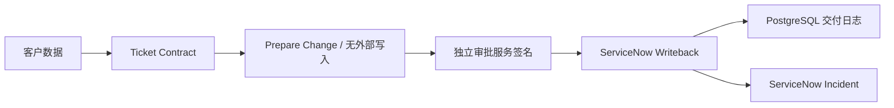

# ServiceBridge · 企业售后智能体交付平台

基于 [Langflow](https://github.com/langflow-ai/langflow) 的可视化流程与组件体系，增加从客户工单契约到独立审批、ServiceNow 写回和持久化回执的交付模块。

## 从演示到可交付集成

| 上游提供 | 本次新增 |
|---|---|
| Langflow 可视化 Agent/RAG 编排与模型组件 | Enterprise Delivery 三个注册组件 |
| Python 组件、Data 输入输出与流程执行身份 | 字段映射、严格工单契约、联系方式清理 |
| 上游 SSRF 校验与 DNS 固定传输工具 | 按执行用户/租户授权的运营方连接配置 |
| 完整前后端平台 | 外部 Ed25519 审批、PostgreSQL 交付日志、ServiceNow Incident 写回 |

注册组件位于 `src/lfx/src/lfx/components/enterprise_delivery/`，通过上游组件目录加载。审批私钥不进入流程，执行侧仅配置公钥。写回前校验调用身份、租户、目标 audience、内容摘要和审批时效。
日志用事务条件更新限制同一变更并发执行。POST 超时或无法确定结果时进入 uncertain，阻止盲目重试；先按 correlation_id 核对并人工处理。不会承诺跨系统 exactly-once。

## 交付资料

- [需求访谈、接入、UAT 与回滚](enterprise/IMPLEMENTATION.md)
- [合成客户工单](enterprise/samples/customer-ticket.json)
- [验证范围](enterprise/VALIDATION.md) · [数据边界](enterprise/DATA_POLICY.md)

按 [上游说明](README.upstream.md) 从本分支构建平台；部署本分支代码后，在组件目录选择三个 Enterprise 组件并按上述流程连线。先完成数据库建表与运营方 profile 配置。真实 ServiceNow 接入需客户提供测试租户和最小权限账号。
Langflow OSS 的默认权限插件不等于完整企业 RBAC。本扩展在连接边界校验执行用户 allowlist；仍需强制登录、隔离运营配置/环境变量、限制自定义代码执行和平台管理权限。

## 归属与许可

新增实现使用 AI 辅助。原有编排平台和组件能力属于 Langflow 及其贡献者；保留 MIT LICENSE、历史和 [原始 README](README.upstream.md)。新增贡献以 [固定基线](enterprise/UPSTREAM.json) 后的 diff 为准。
