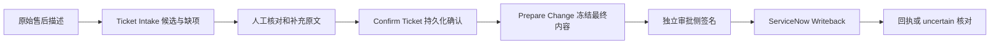
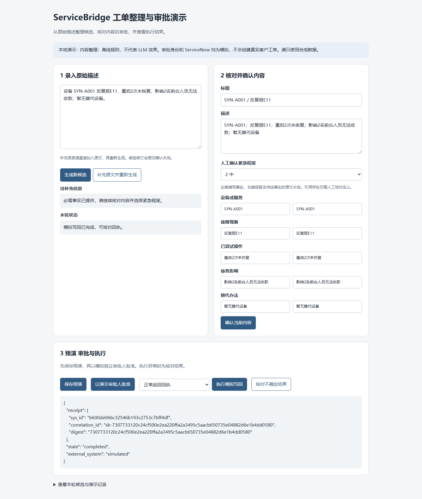

# ServiceBridge · 企业售后智能体交付平台

基于 [Langflow](https://github.com/langflow-ai/langflow) 扩展的售后工单流程，当前扩展版本 **0.2.0**：原始描述 → AI 整理候选、提示缺项 → 人工确认 → 独立审批 → ServiceNow 写回 → 回执与异常核对。

[](https://github.com/hfeiuhog/servicebridge-delivery/actions/workflows/enterprise-ci.yml)

## AI 帮用户做什么

售后专员原本需要阅读描述、整理标题和事实字段、找缺项，再录入工单。这里让模型先整理**可编辑的候选和原文引用**，专员核对并补充信息、确定 urgency。模型不能指定租户、连接目标或审批人，不能直接执行写回。

已接通官方 DeepSeek Flash 并验证合成样本。真实业务中的人工时间、修订量、采用率与 ROI 尚未测量。



## 五个 Langflow 组件

| 组件 | 作用 |
|---|---|
| Enterprise Ticket Intake | 一次有界模型调用；候选事实、引用、缺项问题；失败转人工草稿 |
| Enterprise Confirm Ticket | 校验当前原文及版本，持久化人工确认，生成 confirmation_id |
| Enterprise Prepare Change | 默认要求有效确认，原子冻结内容并保存预演；无外部写入 |
| Enterprise ServiceNow Writeback | 校验审批签名和授权，调用 Incident API，保存回执及执行状态 |
| Enterprise Ticket Contract | 保留结构化源字段映射能力；旧流程需按迁移说明处理 |

源码：`src/lfx/src/lfx/components/enterprise_delivery/`。上游提供编排、组件框架、执行身份与 SSRF 传输工具；本扩展增加候选、确认、审批绑定、交付日志与连接器。本地演示页面单独实现，复用业务内核，不代表完整 Langflow 平台部署。

## 本地演示

仓库根目录，Python 3.12+、uv，PowerShell 示例：

```powershell
uv venv --python 3.12
uv pip install pydantic sqlalchemy cryptography httpx fastapi uvicorn
$env:PYTHONPATH = 'src/lfx/src'
uv run --no-project python enterprise/demo.py --database enterprise/.local/demo.sqlite --mode rules
```

打开 `http://127.0.0.1:7868`，生成候选、核对事实及引用、选择紧急程度，再依次确认、预演、演示审批、模拟写回。可切换“创建成功但响应丢失”，观察 uncertain 与核对结果；不会自动重发。



`rules` 明确显示为离线规则，不代表模型效果。演示只监听本机，审批身份及 ServiceNow 都是合成替身，临时签名私钥仅在进程内生成，不是生产认证方案。

### 真实模型模式

通过运行环境或 Secret 管理器注入 `DEEPSEEK_API_KEY`，不写进代码、流程或 Git。随后运行：

```powershell
uv run --no-project python enterprise/demo.py --database enterprise/.local/deepseek-demo.sqlite --mode deepseek
```

适配器固定官方 `https://api.deepseek.com/chat/completions`，默认 `deepseek-flash`，JSON 输出、关闭 thinking、最多 1536 输出 token，无自动重试。本仓库验证全部使用合成数据。依据：[JSON 模式](https://api-docs.deepseek.com/guides/json_mode/)、[接口](https://api-docs.deepseek.com/api/create-chat-completion/)。

## 合成样本结果

2026-10-24，冻结 intake-v2 后运行：

| 样本 | 模式 | 契约通过 | 缺项集合匹配 | 事实存在性匹配 | 关键词锚点命中 |
|---|---|---:|---:|---:|---:|
| 模板开发集 30 条 | DeepSeek | 28/30 | 28/30 | 136/150 | 124/138 |
| 模板留出集 20 条 | DeepSeek | 19/20 | 19/20 | 93/100 | 85/92 |
| 模板集共 50 条 | 窄规则 | 50/50 | 50/50 | 250/250 | 230/230 |
| 非模板补充集 12 条 | DeepSeek | 12/12 | 8/12 | 55/60 | 40/45 |
| 同一补充集 12 条 | 窄规则 | 12/12 | 1/12 | 26/60 | 11/45 |

这些是自动代理指标，**不是语义准确率**。合成参考标签尚未独立人工复核。规则与模板紧密匹配；补充集很小、非盲评抽样，不能据此宣称模型普遍优于规则。非模板集有 4 条业务影响漏提取，模板集有 3 条模型结果未通过契约，均需人工处理。完整输出、延迟和 token 见 [评测报告](enterprise/evaluation/README.md)。

本地已通过 36 项扩展测试及浏览器操作验证；PostgreSQL 与五组件加载结果以发布 SHA 的 [CI](https://github.com/hfeiuhog/servicebridge-delivery/actions/workflows/enterprise-ci.yml) 为准。真实 ServiceNow、企业身份接入、客户采用和工时节省仍需 UAT。

## 部署与升级

- [实施、接线、UAT 与回滚](enterprise/IMPLEMENTATION.md)
- [验证范围](enterprise/VALIDATION.md) · [数据边界](enterprise/DATA_POLICY.md)
- [0.2.0 变更及迁移](enterprise/CHANGELOG.md) · [上游构建](README.upstream.md)

生产路径要求 PostgreSQL、运营方 profile、强制登录和外部审批侧。确认绑定原文版本、所有者、租户及连接策略，修订失效，预演后不可就地编辑。POST 结果不明确进入 uncertain；不承诺跨系统 exactly-once。

0.2.0 默认不允许未确认 Ticket 直接预演；旧三个组件的类名保持不变。仅运营方可显式设置 `SERVICEBRIDGE_ALLOW_LEGACY_UNCONFIRMED=true` 临时启用旧结构化入口，该模式不提供新增确认保证。

## 归属与许可

新增实现使用 AI 辅助。上游平台属于 Langflow 与其贡献者，保留 MIT LICENSE、历史和 [原始 README](README.upstream.md)。新增贡献以 [固定基线](enterprise/UPSTREAM.json) 后的 diff 为准。不宣称真实客户上线或独立开发上游平台。
